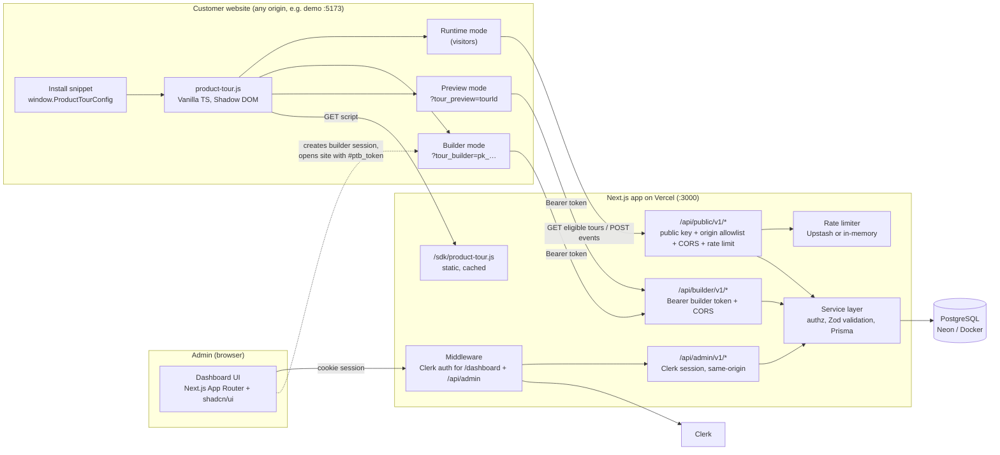
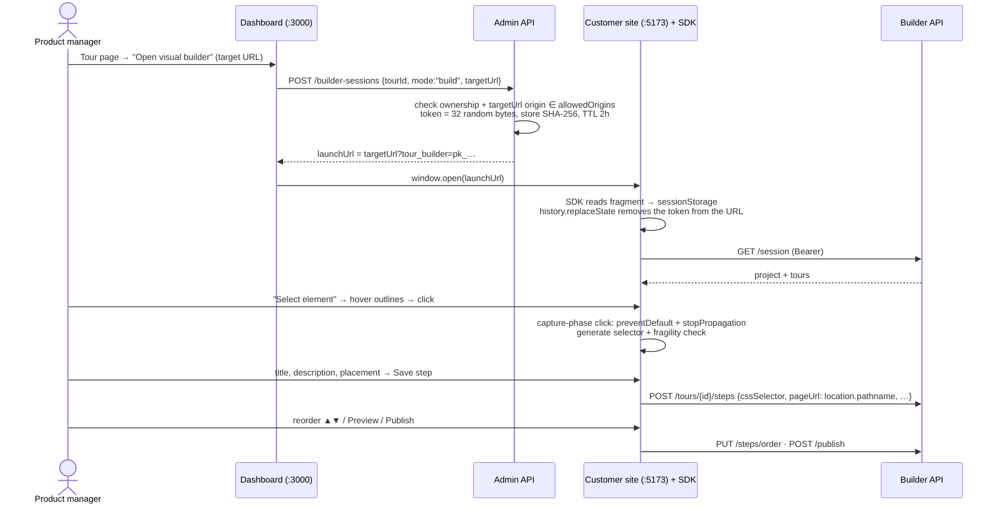

# Product Tour Platform MVP: Phase 1 Architecture & Plan

Status: **Phase 1, for approval.** No application code is written until this is signed off.
Working name: **Waypoint** (original placeholder brand; rename freely). The SDK global is `window.ProductTour` and the config global is `window.ProductTourConfig`, both as specified.

---

## 1. Confirmed architecture & assumptions

### 1.1 Stack decisions

| Concern         | Decision                                                                                                           | Why                                                                                                                                                                 |
| --------------- | ------------------------------------------------------------------------------------------------------------------ | ------------------------------------------------------------------------------------------------------------------------------------------------------------------- |
| Repo            | **pnpm workspaces + Turborepo** monorepo                                                                           | Dashboard, SDK, demo and shared validation schemas need to share types and build in order                                                                           |
| Dashboard + API | **Next.js 15 (App Router), TypeScript, Tailwind v4, shadcn/ui**                                                    | As requested. API is **Route Handlers**, not server actions, so the API contract is explicit, testable with plain HTTP and usable by the SDK                        |
| DB              | **PostgreSQL 16 + Prisma ORM**                                                                                     | As requested. Docker Compose locally, Neon (pooled URL) in production                                                                                               |
| Auth            | **Clerk** (over Supabase Auth)                                                                                     | First-class Next.js App Router middleware. Keyless mode runs locally with no account. We still own a `User` table keyed by `clerkUserId` so the data stays portable |
| Validation      | **Zod**, in `packages/shared`                                                                                      | One schema is used by the API, the dashboard forms and the SDK's type definitions                                                                                   |
| SDK             | **Vanilla TypeScript to a single IIFE bundle (tsup/esbuild)**, one dependency: `@floating-ui/dom`                  | Robust collision-aware positioning without React. Budget: **≤ 25 KB gzipped**                                                                                       |
| SDK isolation   | **Shadow DOM** host attached to `<html>`, `:host { all: initial }`                                                 | Host CSS cannot leak in and our CSS cannot leak out                                                                                                                 |
| Demo site       | **Vite + vanilla TS SPA with a History API router**                                                                | Proves single-page-app URL detection for real. Runs on a different port (a different origin), which proves CORS and the builder auth design                         |
| Rate limiting   | `@upstash/ratelimit` when `UPSTASH_*` env vars are set, **in-memory token bucket fallback** for local dev          | In-memory limits are per-instance on Vercel, so production needs Redis                                                                                              |
| Tests           | **Vitest** (unit + API integration against real Postgres), **happy-dom** for SDK DOM tests, **Playwright** for E2E |                                                                                                                                                                     |

### 1.2 Assumptions (change any before Phase 2)

1. **Single-owner projects.** Each project belongs to one user. Teams and roles are out of scope, but the model leaves room for a `ProjectMember` table in V2.
2. **Plain-text tour content only.** Titles, descriptions and button labels are plain text rendered with `textContent`. No rich text and no HTML, which removes stored XSS by design.
3. **Multi-page tours are supported** (the demo tour needs them: home → product page → cart). Each step has a **concrete `pageUrl` path** (e.g. `/products/aurora-headphones`). When the next step lives on another page, the SDK navigates there and resumes. `startUrl` supports `*` wildcards for eligibility (e.g. `/products/*`).
4. **URL matching ignores query string and hash.** Trailing slashes are normalised and matching is on path only. The host must be in the project's allowed origins.
5. **AUTO tours show once per visitor.** After `tour_completed` or `tour_skipped`, the tour is not auto-started again for that visitor (stored in localStorage). MANUAL tours start via `window.ProductTour.start(tourId)`.
6. **The overlay does not block the page.** The dimmed backdrop is `pointer-events: none`, so scrolling and page interaction keep working. Blocking can be added later as a per-tour option.
7. **Unpublish returns a tour to `DRAFT`.** `ARCHIVED` hides it from the tour list's default view and it can't be published until it's restored.
8. **Analytics are best-effort and not tamper-proof.** Public endpoints can be called by anyone holding the public key. We limit abuse (origin check, rate limits, payload caps, dedupe) but don't treat the numbers as billing-grade.
9. **Desktop browsers only:** the last 2 versions of Chrome, Edge, Firefox and Safari.

### 1.3 Architecture diagram



---

## 2. Repository structure

```text
waypoint/
├─ apps/
│  ├─ web/                                # Next.js dashboard + all APIs
│  │  ├─ prisma/
│  │  │  ├─ schema.prisma
│  │  │  ├─ migrations/                   # generated by `prisma migrate dev`
│  │  │  └─ seed.ts                       # demo user, project, 5-step tour, sample events
│  │  ├─ public/sdk/                      # build output of packages/sdk is copied here
│  │  ├─ src/
│  │  │  ├─ app/
│  │  │  │  ├─ (auth)/sign-in/[[...sign-in]]/page.tsx
│  │  │  │  ├─ (auth)/sign-up/[[...sign-up]]/page.tsx
│  │  │  │  ├─ dashboard/
│  │  │  │  │  ├─ page.tsx                          # project list
│  │  │  │  │  ├─ projects/new/page.tsx             # create project
│  │  │  │  │  └─ projects/[projectId]/
│  │  │  │  │     ├─ page.tsx                       # overview
│  │  │  │  │     ├─ install/page.tsx               # snippet + domain settings
│  │  │  │  │     ├─ tours/page.tsx                 # tour list
│  │  │  │  │     ├─ tours/new/page.tsx
│  │  │  │  │     └─ tours/[tourId]/
│  │  │  │  │        ├─ page.tsx                    # edit tour + step editor
│  │  │  │  │        ├─ preview/page.tsx            # launch preview / builder
│  │  │  │  │        └─ analytics/page.tsx
│  │  │  │  ├─ api/
│  │  │  │  │  ├─ admin/v1/…                        # Clerk-authenticated
│  │  │  │  │  ├─ builder/v1/…                      # builder-token authenticated
│  │  │  │  │  └─ public/v1/…                       # SDK public
│  │  │  │  ├─ layout.tsx
│  │  │  │  └─ page.tsx                             # marketing stub → /dashboard
│  │  │  ├─ components/                   # shadcn/ui + app components
│  │  │  ├─ server/
│  │  │  │  ├─ db.ts                      # Prisma singleton
│  │  │  │  ├─ auth.ts                    # requireUser(): Clerk → User row (upsert)
│  │  │  │  ├─ builder-auth.ts            # token issue / verify (SHA-256 hashed)
│  │  │  │  ├─ cors.ts                    # origin allowlist per project
│  │  │  │  ├─ rate-limit.ts
│  │  │  │  ├─ http.ts                    # json(), errors, body-size guard
│  │  │  │  └─ services/                  # projects.ts, tours.ts, steps.ts, events.ts, analytics.ts
│  │  │  └─ middleware.ts
│  │  ├─ tests/
│  │  │  ├─ api/*.test.ts                 # integration (real Postgres)
│  │  │  └─ unit/*.test.ts
│  │  └─ next.config.ts, tailwind/postcss config, components.json
│  └─ demo/                               # eCommerce demo SPA (Vite)
│     ├─ index.html                       # contains the install snippet
│     ├─ src/{main.ts, router.ts, cart.ts, products.ts, pages/*.ts, styles.css}
│     └─ vite.config.ts
├─ packages/
│  ├─ sdk/
│  │  ├─ src/
│  │  │  ├─ index.ts                      # bootstrap, mode detection, window.ProductTour
│  │  │  ├─ config.ts  api.ts  storage.ts  ids.ts
│  │  │  ├─ url/{match.ts, watch.ts}      # URL patterns, SPA navigation watcher
│  │  │  ├─ runtime/{engine.ts, eligibility.ts, wait-for-element.ts, progress.ts}
│  │  │  ├─ ui/{host.ts, overlay.ts, tooltip.ts, focus-trap.ts, styles.ts}
│  │  │  ├─ analytics/{queue.ts}          # batching + sendBeacon
│  │  │  └─ builder/{panel.ts, picker.ts, selector.ts, builder-api.ts}
│  │  ├─ tests/*.test.ts                  # happy-dom
│  │  └─ tsup.config.ts
│  ├─ shared/                             # Zod schemas, enums, API types, limits
│  │  └─ src/{schemas.ts, enums.ts, limits.ts, url-pattern.ts}
│  └─ config/                             # shared tsconfig + eslint config
├─ e2e/                                   # Playwright: full end-to-end demo flow
├─ docker-compose.yml                     # postgres:16
├─ turbo.json, pnpm-workspace.yaml, package.json
├─ .env.example
└─ README.md, docs/
```

---

## 3. Database model (Prisma)

Design notes:

- `publicKey` format: `pk_` + 24 chars from a URL-safe alphabet. It is validated by regex at the edge before any DB lookup.
- `allowedOrigins` holds full origins (`https://shop.example.com`, `http://localhost:5173`). `domain` is the display/primary domain.
- `@@unique([tourId, stepOrder])` keeps ordering consistent. Reorders run in one transaction that first moves orders to negative values, then assigns the final ones.
- Analytics `stepId` deliberately has **no foreign key**, so history survives step deletion. `stepOrder` is snapshotted on each event.
- `clientEventId` plus a unique index gives idempotent ingestion (`createMany({ skipDuplicates: true })`).
- `currentUrl` is stored **without query string or hash** (stripped by both SDK and server) so tokens and emails in URLs are never collected.
- Builder tokens are stored only as SHA-256 hashes.

```prisma
// apps/web/prisma/schema.prisma
generator client {
  provider = "prisma-client-js"
}

datasource db {
  provider  = "postgresql"
  url       = env("DATABASE_URL")
  directUrl = env("DIRECT_URL")
}

enum TourStatus {
  DRAFT
  PUBLISHED
  ARCHIVED
}

enum TriggerType {
  AUTO
  MANUAL
}

enum Placement {
  TOP
  BOTTOM
  LEFT
  RIGHT
  AUTO
}

enum EventName {
  tour_started
  step_viewed
  next_clicked
  back_clicked
  tour_skipped
  tour_completed
  element_not_found
  tour_error
}

model User {
  id          String   @id @default(cuid())
  clerkUserId String   @unique
  email       String
  name        String?
  createdAt   DateTime @default(now())
  updatedAt   DateTime @updatedAt

  projects        Project[]
  builderSessions BuilderSession[]
}

model Project {
  id             String   @id @default(cuid())
  name           String   @db.VarChar(100)
  domain         String   @db.VarChar(253)
  allowedOrigins String[]
  publicKey      String   @unique @db.VarChar(40)
  createdById    String
  createdBy      User     @relation(fields: [createdById], references: [id], onDelete: Cascade)
  createdAt      DateTime @default(now())
  updatedAt      DateTime @updatedAt

  tours           Tour[]
  events          AnalyticsEvent[]
  builderSessions BuilderSession[]

  @@index([createdById])
}

model Tour {
  id          String      @id @default(cuid())
  projectId   String
  project     Project     @relation(fields: [projectId], references: [id], onDelete: Cascade)
  name        String      @db.VarChar(120)
  description String?     @db.VarChar(500)
  status      TourStatus  @default(DRAFT)
  startUrl    String      @db.VarChar(2048)
  triggerType TriggerType @default(AUTO)
  version     Int         @default(1)      // bumped on publish; SDK resets in-progress state on change
  createdAt   DateTime    @default(now())
  updatedAt   DateTime    @updatedAt
  publishedAt DateTime?
  archivedAt  DateTime?

  steps  TourStep[]
  events AnalyticsEvent[]

  @@index([projectId, status])
}

model TourStep {
  id              String    @id @default(cuid())
  tourId          String
  tour            Tour      @relation(fields: [tourId], references: [id], onDelete: Cascade)
  stepOrder       Int
  title           String    @db.VarChar(120)
  description     String    @db.VarChar(1000)
  cssSelector     String    @db.VarChar(1000)
  pageUrl         String    @db.VarChar(2048)
  placement       Placement @default(AUTO)
  nextButtonLabel String    @default("Next") @db.VarChar(30)
  backButtonLabel String    @default("Back") @db.VarChar(30)
  allowSkip       Boolean   @default(true)
  createdAt       DateTime  @default(now())
  updatedAt       DateTime  @updatedAt

  @@unique([tourId, stepOrder])
}

model BuilderSession {
  id          String    @id @default(cuid())
  tokenHash   String    @unique @db.Char(64)
  projectId   String
  project     Project   @relation(fields: [projectId], references: [id], onDelete: Cascade)
  tourId      String?
  createdById String
  createdBy   User      @relation(fields: [createdById], references: [id], onDelete: Cascade)
  expiresAt   DateTime
  revokedAt   DateTime?
  lastUsedAt  DateTime?
  createdAt   DateTime  @default(now())

  @@index([projectId])
}

model AnalyticsEvent {
  id                 String    @id @default(cuid())
  clientEventId      String    @db.VarChar(64)
  projectId          String
  project            Project   @relation(fields: [projectId], references: [id], onDelete: Cascade)
  tourId             String
  tour               Tour      @relation(fields: [tourId], references: [id], onDelete: Cascade)
  tourVersion        Int
  stepId             String?
  stepOrder          Int?
  anonymousVisitorId String    @db.VarChar(64)
  sessionId          String    @db.VarChar(64)
  eventName          EventName
  currentUrl         String    @db.VarChar(2048)
  occurredAt         DateTime  // client timestamp, clamped to ±24h of receivedAt
  receivedAt         DateTime  @default(now())
  errorCode          String?   @db.VarChar(64)   // only for element_not_found / tour_error

  @@unique([projectId, clientEventId])
  @@index([tourId, eventName, occurredAt])
  @@index([tourId, stepOrder, eventName])
}
```

> Prisma version note: Phase 2 pins the Prisma major explicitly. If Prisma 7 is used, `url`/`directUrl` move to `prisma.config.ts` and the generator becomes `prisma-client` with a driver adapter (`@prisma/adapter-pg`). The models above are unchanged either way.

---

## 4. API contract

**Common rules.** JSON in and out. Errors use `{ "error": { "code": "VALIDATION_ERROR", "message": "…", "details"?: […] } }`. Every body is validated with Zod and capped (32 KB for public, 64 KB for admin). Admin resources the user doesn't own return **404** (not 403), so IDs can't be enumerated.

### 4.1 Public SDK API: no cookies, CORS restricted to the project's `allowedOrigins`

| Method  | Path                                                         | Auth                                    | Request                                                                                | Response                                                                                                                                                      | Notes                                                                                                                                                 |
| ------- | ------------------------------------------------------------ | --------------------------------------- | -------------------------------------------------------------------------------------- | ------------------------------------------------------------------------------------------------------------------------------------------------------------- | ----------------------------------------------------------------------------------------------------------------------------------------------------- |
| GET     | `/sdk/product-tour.js`                                       | none                                    |                                                                                        | JS bundle                                                                                                                                                     | `Cache-Control: public, max-age=300, stale-while-revalidate=86400`                                                                                    |
| GET     | `/api/public/v1/projects/{publicKey}/tours?path=/products/x` | public key + `Origin` allowlist         |                                                                                        | `{ tours: PublicTour[] }`: PUBLISHED tours whose `startUrl` matches `path`, or that contain a step whose `pageUrl` matches (for resuming), with ordered steps | Rate limit 120/min per IP+key. `Vary: Origin`. CDN cache 60 s                                                                                         |
| POST    | `/api/public/v1/events`                                      | public key in body + `Origin` allowlist | `Content-Type: text/plain` body containing JSON `{ projectKey, events: Event[1..20] }` | `202 { accepted: n }`                                                                                                                                         | `text/plain` avoids a CORS preflight, so `navigator.sendBeacon` works on page unload. Rate limit 60/min per IP+key. Unknown `tourId`/`stepId` dropped |
| OPTIONS | both of the above                                            |                                         |                                                                                        | CORS preflight                                                                                                                                                | Only echoes `Access-Control-Allow-Origin` when the origin is allowlisted. Never `*`                                                                   |

`PublicTour = { id, version, name, triggerType, startUrl, steps: [{ id, stepOrder, title, description, cssSelector, pageUrl, placement, nextButtonLabel, backButtonLabel, allowSkip }] }`. No internal fields such as `createdById`.

`Event = { clientEventId, tourId, tourVersion, stepId?, stepOrder?, anonymousVisitorId, sessionId, eventName, currentUrl, timestamp, errorCode? }`

### 4.2 Builder API: `Authorization: Bearer <builder token>`, CORS restricted to `allowedOrigins`

| Method | Path                                                    | Purpose                                                                                          |
| ------ | ------------------------------------------------------- | ------------------------------------------------------------------------------------------------ |
| GET    | `/api/builder/v1/session`                               | Validate token. Returns `{ project: {id,name,publicKey}, tours: [{id,name,status}], expiresAt }` |
| POST   | `/api/builder/v1/tours`                                 | Create a draft tour from the builder panel                                                       |
| GET    | `/api/builder/v1/tours/{tourId}`                        | Tour + steps, **including drafts** (used by builder and preview)                                 |
| POST   | `/api/builder/v1/tours/{tourId}/steps`                  | Add step `{ title, description, cssSelector, pageUrl, placement, … }`                            |
| PATCH  | `/api/builder/v1/steps/{stepId}`                        | Update step                                                                                      |
| DELETE | `/api/builder/v1/steps/{stepId}`                        | Delete step (remaining steps re-sequenced)                                                       |
| PUT    | `/api/builder/v1/tours/{tourId}/steps/order`            | `{ stepIds: string[] }`: must be an exact permutation                                            |
| POST   | `/api/builder/v1/tours/{tourId}/publish` · `/unpublish` | Same rules as admin                                                                              |

The token is scoped to one project. Every handler verifies the target tour/step belongs to that project.

### 4.3 Admin API: Clerk session cookie, same-origin only (no CORS headers)

| Method               | Path                                                  | Purpose                                                                                                                                  |
| -------------------- | ----------------------------------------------------- | ---------------------------------------------------------------------------------------------------------------------------------------- |
| GET / POST           | `/api/admin/v1/projects`                              | List mine / create `{ name, domain, allowedOrigins[] }`. Server generates `publicKey`                                                    |
| GET / PATCH / DELETE | `/api/admin/v1/projects/{projectId}`                  | Read / update name, domain, origins / delete                                                                                             |
| GET                  | `/api/admin/v1/projects/{projectId}/install`          | `{ snippet, sdkUrl, publicKey }` built from `NEXT_PUBLIC_SDK_URL`                                                                        |
| GET / POST           | `/api/admin/v1/projects/{projectId}/tours`            | List (`?status=`) / create `{ name, description?, startUrl, triggerType }`                                                               |
| GET / PATCH / DELETE | `/api/admin/v1/tours/{tourId}`                        | Read with steps / update metadata / delete                                                                                               |
| POST                 | `/api/admin/v1/tours/{tourId}/publish`                | Requires ≥1 step and all steps valid. Sets `PUBLISHED`, `publishedAt`, `version++`                                                       |
| POST                 | `/api/admin/v1/tours/{tourId}/unpublish`              | → `DRAFT`                                                                                                                                |
| POST                 | `/api/admin/v1/tours/{tourId}/archive` · `/restore`   | → `ARCHIVED` / → `DRAFT`                                                                                                                 |
| GET / POST           | `/api/admin/v1/tours/{tourId}/steps`                  | List / add (manual selector entry in the dashboard)                                                                                      |
| PATCH / DELETE       | `/api/admin/v1/steps/{stepId}`                        | Update / delete                                                                                                                          |
| PUT                  | `/api/admin/v1/tours/{tourId}/steps/order`            | Reorder                                                                                                                                  |
| POST                 | `/api/admin/v1/projects/{projectId}/builder-sessions` | `{ tourId?, mode: "build" \| "preview", targetUrl }` → `{ launchUrl, expiresAt }`. Token returned **only inside `launchUrl`'s fragment** |
| DELETE               | `/api/admin/v1/builder-sessions/{id}`                 | Revoke                                                                                                                                   |
| GET                  | `/api/admin/v1/tours/{tourId}/analytics?from=&to=`    | See §4.4                                                                                                                                 |

### 4.4 Analytics response

```json
{
  "range": { "from": "…", "to": "…" },
  "uniqueVisitorsStarted": 120,
  "totalStarts": 150,
  "totalCompletions": 81,
  "completionRate": 0.54,
  "totalSkips": 39,
  "skipRate": 0.26,
  "elementNotFound": 4,
  "steps": [
    {
      "stepOrder": 1,
      "stepId": "…",
      "title": "Search",
      "uniqueViewers": 120,
      "pctOfStarters": 1.0,
      "dropOffFromPrevious": 0,
      "elementNotFound": 0
    }
  ]
}
```

Rates are computed per tour start (`completions / starts`, `skips / starts`). Drop-off is the count of distinct visitors who viewed step _n_ compared with step _n-1_. All of it comes from SQL aggregates (`COUNT(DISTINCT anonymousVisitorId)` grouped by `stepOrder`). No real-time processing.

---

## 5. Authentication approach

| Surface                                | Mechanism                                                                                                                                                                       |
| -------------------------------------- | ------------------------------------------------------------------------------------------------------------------------------------------------------------------------------- |
| Dashboard pages + `/api/admin/*`       | Clerk middleware. `requireUser()` maps the Clerk user to our `User` row, created on first sight. All service functions take `userId` and scope queries by `project.createdById` |
| Builder / preview on the customer site | **Short-lived builder token**, minted by the dashboard (see §7). Not a cookie, so third-party cookie blocking doesn't matter                                                    |
| Public SDK                             | **Public key** (not a secret) + `Origin` allowlist + rate limits. No secrets ever reach the browser. Clerk secret keys stay server-side                                         |

---

## 6. SDK design & lifecycle

**Public surface**

```ts
window.ProductTourConfig = { projectId: "pk_…", apiBase?: string, debug?: boolean };
window.ProductTour = { start(tourId: string): void; stop(): void; reset(): void; version: string };
```

`apiBase` defaults to the origin the script was loaded from (`document.currentScript.src`), so a single env var (`NEXT_PUBLIC_SDK_URL`) controls the snippet.

**Lifecycle**

```mermaid
stateDiagram-v2
  [*] --> Boot: script loaded (async)
  Boot --> Inert: no/invalid projectId → console.warn once, do nothing
  Boot --> ModeSelect: projectId valid (pk_ regex)
  ModeSelect --> Builder: ?tour_builder=pk + #ptb_token
  ModeSelect --> Preview: ?tour_preview=tourId + #ptb_token
  ModeSelect --> Runtime: default
  Runtime --> Fetch: on load and on every SPA URL change (debounced 150 ms)
  Fetch --> Resume: sessionStorage has in-progress tour + same version + step pageUrl matches
  Fetch --> Evaluate: otherwise
  Evaluate --> Idle: no eligible AUTO tour (seen/completed/skipped, or path mismatch)
  Evaluate --> WaitElement: eligible → tour_started
  Resume --> WaitElement
  WaitElement --> ShowStep: element found (MutationObserver, ≤5 s)
  WaitElement --> NotFound: timeout
  NotFound --> ShowStep: element_not_found logged → skip to next step if one exists
  NotFound --> Teardown: no steps left → end gracefully
  ShowStep --> ShowStep: Next / Back (same page)
  ShowStep --> Navigate: next step on a different pageUrl → save progress → location.assign
  Navigate --> Fetch
  ShowStep --> Teardown: Skip / Close / Escape → tour_skipped
  ShowStep --> Teardown: Finish → tour_completed
  Teardown --> Idle: remove DOM, listeners, observers; restore focus; flush analytics
  Idle --> Fetch: URL change / ProductTour.start()
  Preview --> WaitElement: plays draft tour, events NOT recorded
```



**Key mechanics**

- **Rendering.** One `<div data-ptour-host>` appended to `document.documentElement` with an open Shadow Root. It holds the highlight ring, the backdrop and the tooltip. The z-index is `2147483000`, high but below the 32-bit max so a host's own critical layers can still win. The backdrop is a `position: fixed` highlight box with a large `box-shadow` spread for the dimming, set to `pointer-events: none`. **The host DOM is never mutated** apart from the one host node, plus (temporarily) the picker's outline in builder mode, which lives inside our shadow root, not on host elements.
- **Positioning.** `@floating-ui/dom` `computePosition` with `offset`, `flip`, `shift`, `arrow`, and `autoPlacement` for `AUTO`. `autoUpdate` recalculates on scroll, resize, layout shift and element resize. If the target is outside the viewport, it's brought in with `scrollIntoView({ block: "center", behavior: "smooth" })` (instant when `prefers-reduced-motion`).
- **Element lookup.** `document.querySelector` inside try/catch (an invalid selector counts as not found). If the element is missing, a `MutationObserver` with a 5 s timeout waits for it. Elements that are zero-size or `visibility: hidden` count as not found.
- **SPA URL detection.** The Navigation API (`navigation.addEventListener("navigate")`) where available. Otherwise `popstate` + `hashchange`, plus a thin wrapper around `history.pushState`/`replaceState` that calls the original and dispatches an internal event. The wrapper is installed once, never changes behaviour, and is removed by `ProductTour.stop()`/teardown when possible. If the URL changes and the active step's `pageUrl` no longer matches, the tooltip is hidden, and the tour resumes if a matching URL returns.
- **Accessibility.** The tooltip is `role="dialog"`, `aria-modal="true"`, with `aria-labelledby` (title) and `aria-describedby` (description). The step counter "2 of 5" is in an `aria-live="polite"` region. Focus moves to the tooltip on show and Tab/Shift+Tab are trapped inside it. Escape closes the tour (= skip). The close button has an `aria-label`. Focus is restored to the previously focused element on teardown. Buttons are real `<button>`s with visible focus rings.
- **State.** `localStorage`: `ptour:vid` (UUID), `ptour:seen:{tourId}` → `completed|skipped@version`. `sessionStorage`: `ptour:sid` (30-min idle rotation), `ptour:active` → `{ tourId, version, stepIndex }`. All storage access is wrapped in try/catch with in-memory fallback (Safari private mode, sandboxed iframes).
- **Analytics queue.** Events are batched (flush every 2 s or 10 events) via `fetch(..., { keepalive: true })`. On `pagehide`/`visibilitychange=hidden` the queue flushes via `sendBeacon`. Failures retry once and are then dropped. Analytics never block the UI.
- **Safety.** All text is set with `textContent`, with no `innerHTML` anywhere (enforced by an ESLint rule `no-restricted-properties` in `packages/sdk`). The SDK never reads input values, page text or DOM content. It sends only IDs, the event name and the path-only URL. The whole SDK runs in a top-level try/catch: any internal error becomes `tour_error` and teardown, never a thrown exception on the host page.

---

## 7. Authoring-mode design

**Why a token and not the dashboard's cookie:** the builder runs on the customer's origin (`:5173`), and the dashboard session cookie lives on `:3000`. Sending it cross-site would need `SameSite=None` third-party cookies, which browsers block. So the dashboard mints a scoped, short-lived capability token instead.



- The token travels in the **URL fragment**, so it is never sent in an HTTP request, never logged by servers and never leaked via `Referer`. It is removed from the address bar immediately.
- Opening `?tour_builder=pk_…` without a valid token shows the panel in a locked state: "Open the builder from your dashboard to sign in."
- **Picker.** It uses capture-phase `pointermove`/`click`/`keydown` listeners on `window`, and the outline is drawn inside our shadow root (no host style changes). Esc cancels picking, and events inside our own panel are ignored. Pointer and click events are suppressed only while picking is active.
- **Panel.** A floating, draggable panel (shadow DOM) with: tour selector / "new tour", step list (reorder ▲▼, edit, delete), selector field (editable, with a live "matches N elements" check), fragility warning, title, description, placement, button labels, allow-skip, Save, Preview, Publish/Unpublish.
- **Multi-page authoring.** The builder token and selected tour persist in `sessionStorage`, so the PM can navigate the site (clicks work normally when not picking) and add steps on other pages. Each step records `location.pathname` as its `pageUrl`.
- **Preview** runs the draft tour in-page using the same renderer as production, with analytics disabled. It's also available from the dashboard via a `mode: "preview"` session and `?tour_preview=tourId`.

### Selector strategy (`builder/selector.ts`)

Selectors are tried in priority order, and each candidate must match **exactly one element** (`querySelectorAll(c).length === 1`). All values are escaped with `CSS.escape`.

1. `[data-tour-id="…"]` → **stable**
2. `#id`, if the id doesn't look generated → stable
3. Other stable data attributes: `data-testid`, `data-test`, `data-cy`, `data-qa`, `data-id`, `name` (for form fields) → stable
4. `tag[aria-label="…"]`, `tag[role="…"][aria-label]`, `button[title]`, `img[alt]` → good
5. `tag.stableClass` (up to 2 classes) → ok
6. If nothing is unique, the closest ancestor that has a stable anchor (any of 1–5) plus a descendant path; finally `nth-of-type` chain → **fragile**

**Generated-value heuristics** (rejected for ids/classes): CSS-in-JS prefixes (`css-`, `sc-`, `jsx-`, `emotion-`, `svelte-`), CSS-module hash suffixes (`_[a-z0-9]{5,}$`, `__[a-zA-Z0-9]{5}`), ≥ 4 digits, long hex/base64-looking runs, framework ids (`:r1:`, `radix-`, `headlessui-`, `ember\d+`), and Tailwind state/arbitrary classes (`hover:`, `[`, `/`).

**Fragility result** `{ selector, quality: "stable" | "good" | "fragile", reasons[] }`. Fragile selectors show a yellow warning with the recommendation to add `data-tour-id="add-to-cart"` and a copyable snippet.

---

## 8. Security model

| Threat                            | Control                                                                                                                                                                                                                  |
| --------------------------------- | ------------------------------------------------------------------------------------------------------------------------------------------------------------------------------------------------------------------------ |
| Stored XSS via tour content       | Plain text only. Zod length limits, control characters stripped, `textContent` rendering in the SDK, React escaping in the dashboard, lint ban on `innerHTML`/`outerHTML`/`insertAdjacentHTML`/`dangerouslySetInnerHTML` |
| Selector injection                | Selectors are only ever passed to `querySelector` (no evaluation), length-capped, invalid ones caught                                                                                                                    |
| Unauthorised admin access         | Clerk on `/dashboard/*` and `/api/admin/*`. Every query is scoped by owner. 404 on foreign IDs                                                                                                                           |
| Builder token theft               | 256-bit random, SHA-256 at rest, 2 h TTL, project-scoped, revocable, delivered via fragment, kept in `sessionStorage` (cleared when the tab closes), sent as a header (no CSRF surface)                                  |
| Cross-origin abuse of public APIs | `publicKey` regex validation; `Origin` must be in `allowedOrigins` (CORS + server-side check); no credentials; no wildcard CORS                                                                                          |
| Analytics spam / DoS              | Per-IP+key rate limits, 32 KB body cap, ≤ 20 events/batch, enum/length validation, timestamp clamping, idempotent `clientEventId`, unknown tour/step dropped                                                             |
| CSRF on admin API                 | Same-origin JSON API. Clerk `SameSite=Lax` cookies. State-changing routes require `Content-Type: application/json` and a matching `Origin`                                                                               |
| Privacy                           | No form values, page text, DOM snapshots, IPs (rate-limit keys are hashed in memory/Redis only, never stored in the DB) or query strings collected. The visitor ID is random and anonymous                               |
| Host page breakage                | Shadow DOM, a single host node, no global style injection, a try/catch boundary, complete teardown, controlled z-index                                                                                                   |
| Secret exposure                   | Only `NEXT_PUBLIC_*` values reach the client: Clerk publishable key, SDK URL. `.env.example` documents each var's exposure                                                                                               |
| Auditability                      | `createdAt`/`updatedAt` on every row, `publishedAt`/`archivedAt` on tours, `BuilderSession.lastUsedAt`/`revokedAt`                                                                                                       |
| Response hardening                | Dashboard: CSP, `X-Frame-Options: DENY`, `Referrer-Policy: strict-origin-when-cross-origin`, `X-Content-Type-Options: nosniff`                                                                                           |

**Customer CSP requirement (documented on the install page):** `script-src` and `connect-src` must allow the SDK origin.

---

## 9. Technical risks & mitigations

| #   | Risk                                                                                      | Impact                                                           | Mitigation                                                                                                                                            |
| --- | ----------------------------------------------------------------------------------------- | ---------------------------------------------------------------- | ----------------------------------------------------------------------------------------------------------------------------------------------------- |
| 1   | Builder auth across origins (third-party cookies blocked)                                 | Builder can't save                                               | Fragment-delivered, scoped bearer token (§7)                                                                                                          |
| 2   | `sendBeacon` with JSON triggers CORS preflight and silently fails                         | Lost `skip`/`complete` events on navigation                      | `text/plain` body, server parses JSON. `fetch keepalive` as primary                                                                                   |
| 3   | Fragile selectors on React/Tailwind/CSS-in-JS sites                                       | Tours break after deploys                                        | Priority strategy, uniqueness check, fragility warnings, `data-tour-id` guidance, `element_not_found` analytics                                       |
| 4   | Target rendered late (SPA, lazy loading, data fetches)                                    | False "not found"                                                | MutationObserver wait (5 s), re-evaluate on URL change                                                                                                |
| 5   | Positioning edge cases: sticky headers, transformed ancestors, nested scroll containers   | Misplaced tooltip                                                | Floating UI `autoUpdate`, `position: fixed` strategy, highlight from `getBoundingClientRect` each frame while visible                                 |
| 6   | SPA routers we can't observe directly                                                     | Tour doesn't start/advance                                       | Navigation API → history wrapper → `popstate`/`hashchange`. Manual `ProductTour.start()` as escape hatch                                              |
| 7   | Host CSS / z-index wars                                                                   | Tooltip hidden or restyled                                       | Shadow DOM + `all: initial`, top-level host on `<html>`, z-index 2147483000                                                                           |
| 8   | Host page CSP blocks script or API calls                                                  | SDK silently absent                                              | Documented CSP lines; SDK logs one clear console warning in `debug` mode                                                                              |
| 9   | Rate limiting on serverless is per-instance                                               | Limits ineffective in production                                 | Upstash Redis in production. In-memory only for dev                                                                                                   |
| 10  | Public key is public, so analytics can be forged from outside a browser                   | Polluted metrics                                                 | Accept for MVP (documented). Rate limits + validation cap damage. V2: signed visitor tokens / anomaly filtering                                       |
| 11  | Multi-page tour state & version drift (tour edited mid-tour)                              | Wrong step shown                                                 | `version` field; mismatched in-progress state is discarded                                                                                            |
| 12  | Serverless Postgres connection exhaustion                                                 | 500s under load                                                  | Neon pooled connection string for runtime, direct URL for migrations, Prisma singleton                                                                |
| 13  | Event table growth                                                                        | Slow analytics                                                   | Composite indexes now. V2: daily rollup table + retention policy                                                                                      |
| 14  | Clerk dependency for E2E tests                                                            | Flaky/blocked CI                                                 | `@clerk/testing` for dashboard E2E. The SDK E2E path uses a builder session created directly via a test-only seed helper (never routed in production) |
| 15  | **This workspace currently can't download packages** (network access for installs is off) | Phase 2+ can't be installed, linted, type-checked or tested here | See the note at the end of this document                                                                                                              |

---

## 10. Implementation sequence

| Phase                         | Deliverables                                                                                                                                                                                                                       | Exit gate                                                                                                                                 |
| ----------------------------- | ---------------------------------------------------------------------------------------------------------------------------------------------------------------------------------------------------------------------------------- | ----------------------------------------------------------------------------------------------------------------------------------------- |
| **2. Foundation & dashboard** | Monorepo scaffold, shared Zod package, Docker Compose, Prisma schema + first migration, Clerk integration, service layer, all admin + builder routes, dashboard pages 1–8 and 10 (analytics page shell), install page with snippet | `pnpm lint && pnpm typecheck && pnpm test` green. API integration tests cover ownership, validation, publish rules, reorder               |
| **3. SDK runtime**            | Shadow host, overlay, tooltip, Floating UI, navigation, keyboard/focus, wait-for-element, URL matcher, SPA watcher, progress/resume, analytics queue, teardown, public endpoints with CORS + rate limit                            | SDK unit tests (happy-dom). Bundle ≤ 25 KB gz checked in CI. No `innerHTML` (lint)                                                        |
| **4. Authoring mode**         | Builder token issue/verify, panel, picker, selector generator + fragility, step CRUD/reorder from panel, preview mode, publish/unpublish                                                                                           | Selector test suite (~30 fixtures incl. generated-class cases). Builder API tests                                                         |
| **5. Analytics, demo, E2E**   | Ingestion with dedupe, analytics aggregates + page (tables, progress bars), Vite demo shop, seed with the "Find a Product and Add It to Cart" tour + sample events, Playwright E2E                                                 | E2E: visitor completes the 5-step tour across 3 pages. Events land in the DB. Analytics page shows them. Skip and not-found paths covered |
| **6. Ship**                   | Vercel config, Neon setup, env docs, README, limitations, V2 roadmap, security headers                                                                                                                                             | Clean production build. Fresh-clone setup works by following the README                                                                   |

---

## 11. Acceptance criteria (MVP)

**Projects & install**

- [ ] A signed-in user can create a project with a name, domain and ≥ 1 allowed origin. A `pk_…` key is generated.
- [ ] The install page shows a copyable snippet using `NEXT_PUBLIC_SDK_URL`.
- [ ] A user can't see or modify another user's projects (API returns 404).

**Tours & steps**

- [ ] Create/edit tours with name, description, start URL (wildcards allowed) and AUTO/MANUAL trigger.
- [ ] Add/edit/delete/reorder steps from both the dashboard and the in-page builder. All step fields from the spec are persisted.
- [ ] Publishing requires ≥ 1 valid step. Publish/unpublish/archive transitions work and `publishedAt` is set.

**SDK runtime**

- [ ] With the snippet installed, a published AUTO tour starts on a matching page. A DRAFT tour never appears to visitors.
- [ ] Target highlighted, page dimmed, tooltip placed per `placement`, counter "n of N", Next/Back/Skip/Finish/Close all work.
- [ ] Repositions on scroll/resize. Scrolls offscreen targets into view. The page still scrolls during a tour.
- [ ] Keyboard: Tab is trapped in the tooltip, Escape closes, and focus is restored afterwards. axe-core reports no violations on the tooltip.
- [ ] Multi-page: the tour continues across demo pages and through SPA route changes without a reload.
- [ ] Missing element → `element_not_found` recorded, no exception on the host page, tour continues or ends gracefully.
- [ ] After the tour ends, no SDK DOM nodes, listeners, observers or timers remain (verified in tests).
- [ ] A completed/skipped AUTO tour doesn't start again for the same visitor.
- [ ] Host CSS (e.g. global `* { font-size: 40px !important }`) doesn't affect the tooltip.

**Authoring**

- [ ] A launch from the dashboard opens the demo site in builder mode. The token is removed from the URL. Opening without a token shows the locked state.
- [ ] Hover outlines elements, click selects without triggering the element's action, and a selector is generated per the priority order. Fragile selectors show a warning.
- [ ] Steps saved from the builder appear in the dashboard immediately. Preview plays the draft without recording analytics.

**Analytics**

- [ ] All 8 event types are recorded with the required fields. URLs are stored without query/hash.
- [ ] The analytics page shows unique starters, starts, completions, completion %, skips, skip %, per-step drop-off and not-found counts.
- [ ] Public endpoints reject non-allowlisted origins, malformed keys, oversized bodies and excess rates (429).

**Quality**

- [ ] `pnpm lint`, `pnpm typecheck`, `pnpm test` and `pnpm e2e` pass from a fresh clone following the README.

---

## 12. Open decisions (defaults applied unless changed)

1. **Auth provider:** Clerk (default) or Supabase Auth.
2. **Overlay behaviour:** non-blocking (default) or block clicks outside the highlighted element.
3. **Demo stack:** Vite SPA (default, proves SPA support) or a second Next.js app.
4. **Product name:** "Waypoint" placeholder.

## Note on this workspace

Package installs from this workspace are currently blocked: network access is off for the shell, so `npm`/`pnpm install` fails. Node 22, pnpm 10, Docker and PostgreSQL 16 are present. To build, lint, type-check and test Phases 2–6 here, allow package installs in your network settings and start a new chat (the current chat may not pick up the change). Without that, the code can still be written in full, but it can't be verified here.
